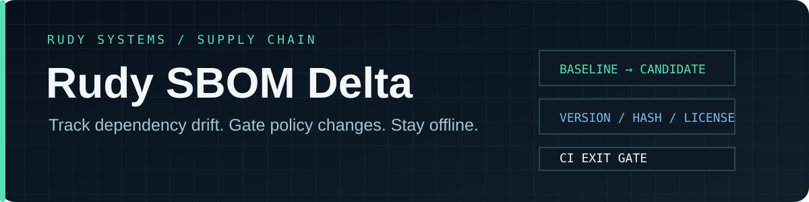

<p align="center">
  
</p>

<p align="center">
  <a href="https://github.com/r4venrudy/rudy-sbom-delta/actions/workflows/ci.yml"></a>
  
  
  <a href="LICENSE"></a>
</p>

<p align="center"><strong>Diff software inventories. Gate the changes that matter.</strong><br>One local C++ tool for repeatable SBOM review in developer workflows and CI.</p>

---

## What it does

Rudy SBOM Delta compares a baseline SBOM with a candidate SBOM and reports added or removed components plus version, checksum, and license drift. It accepts SPDX JSON 2.2/2.3 and CycloneDX JSON 1.4–1.7, so teams can compare across these two common inventory formats without sending manifests to a service.

Use it as a build gate with `--fail-on` and candidate license/hash policies. Output is readable text for a terminal, JSON for automation, or CSV for review workflows.

| Capability | Behavior |
| --- | --- |
| Format normalization | SPDX package records and CycloneDX root, top-level, and nested components |
| Stable matching | Prefer PURLs without their version; fall back to case-insensitive component names |
| Drift review | Added, removed, version, selected checksum, and declared license changes |
| Policy gate | Fail on selected drift, denied license identifiers, or missing candidate checksums |
| CI output | Text, JSON, or CSV; exit codes `0` clean, `1` gate triggered, `2` invalid input |
| Bounded local parsing | No network access; caps input size, JSON depth, parsed values, and component count |

## Quick start

Build with a C++20 compiler and CMake 3.20 or newer. No third-party libraries are required.

```sh
cmake -S . -B build -DCMAKE_BUILD_TYPE=Release
cmake --build build --config Release
ctest --test-dir build -C Release --output-on-failure
```

Compare the included sample inventories:

```sh
./build/rudy-sbom-delta examples/baseline.spdx.json examples/candidate.cdx.json
```

On Windows, the executable is usually at `build\Release\rudy-sbom-delta.exe` when using a multi-configuration generator.

## CI examples

Fail on dependency additions or removals and return machine-readable JSON:

```sh
rudy-sbom-delta --format json --fail-on added,removed baseline.json candidate.json
```

Reject an exact license identifier and require candidate checksums:

```sh
rudy-sbom-delta --deny-license GPL-3.0-only --require-hashes baseline.json candidate.json
```

`--fail-on any` treats any reported drift as a failing build. License denial checks exact identifier tokens case-insensitively; it does not evaluate full SPDX expressions or make legal determinations.

## Format and scope

Rudy SBOM Delta supports SPDX JSON 2.2/2.3 and CycloneDX JSON 1.4–1.7. It does not currently read XML, SPDX 3.x, or CycloneDX Protobuf. Matching by name alone can conflate same-named components in different namespaces; include PURLs in generated SBOMs where available. Hash comparison selects SHA-256 when present, otherwise the first recorded checksum.

This is an inventory comparison and build-policy utility. It does not discover vulnerabilities, verify SBOM provenance or completeness, download packages, inspect binaries, or establish what is running in production. Read the [design and support notes](docs/design.md) before relying on a policy gate.

## Project map

| Path | Purpose |
| --- | --- |
| `src/sbom.cpp` | Bounded JSON parsing, format normalization, comparison, and policy checks |
| `src/main.cpp` | CLI, output serialization, and CI exit behavior |
| `tests/` | Format, normalization, safety, policy, and CLI integration tests |
| `examples/` | Small SPDX and CycloneDX inputs for a cross-format diff |
| `.github/workflows/ci.yml` | Linux, macOS, Windows, plus Linux ASan/UBSan validation |

## Validation

CI builds with C++20 on Linux, macOS, and Windows, runs the core and CLI tests, and exercises the parser with AddressSanitizer and UndefinedBehaviorSanitizer on Linux.

## License

MIT. See [LICENSE](LICENSE).

<p align="center"><sub>Built by <a href="https://github.com/r4venrudy">Rudy Systems</a> · Defensive developer tooling · Local files only</sub></p>
